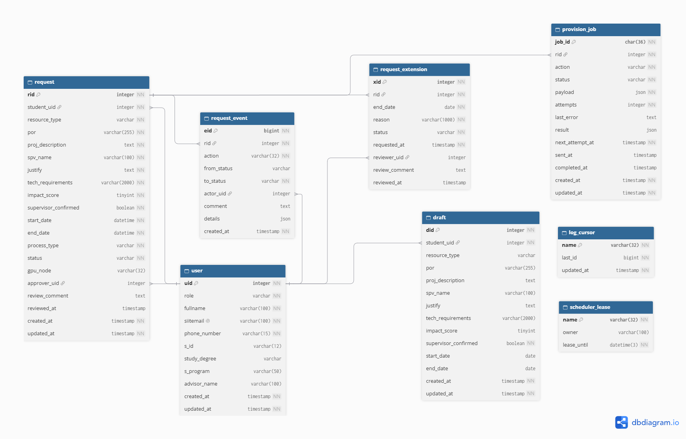

# Database Usage

This directory contains the MySQL initialization script for the SIIT ICT Resource
Request System.

- `init.sql` creates the application tables.
- `privileges.sh` runs after it and gives each database user data rights on the tables it uses
  only, with just `SELECT` and `INSERT` on the `request_event` audit log for all of them
  (FR-9.1). Root (the admin user) owns the schema.
  - docker compose: one user (`MYSQL_USER`) for the single backend process (`SERVICE_ROLE=all`).
  - AWS (D34): one user per service, made when its password is set (the data stack generates
    them):

    | User | Service | Rights |
    |---|---|---|
    | `siit_identity` | sign-in, profiles | `user`: select, insert, update |
    | `siit_requests` | requests, review, drafts | `user`: select; `request`: select, insert, update; `draft`: all four; `request_extension`: select, insert, update; `request_event`, `provision_job`: select, insert |
    | `siit_provisioning` | site jobs and results, scheduler, audit shipping | `user`: select; `request`: select, update; `request_event`: select, insert; `provision_job`: select, insert, update; `scheduler_lease`, `log_cursor`: select, update |

    `backend/scripts/check-grants.js` checks that a user has exactly these rights.
- `rds-init.sh` (RDS, D31) does the same on RDS, where the image's first-start scripts can't run:
  it connects as the RDS admin over TLS (certificate and host name checked), runs `init.sql` while
  the database has no tables, then sources `privileges.sh`. With `SOURCE_DB_HOST` it first copies
  the data of the ECS MySQL in one transaction, only into a database without accounts, and
  compares the row counts (`infra/scripts/switch-to-rds.sh`). The rds stack runs it as a one-off
  task after each deploy; running it again changes nothing but the passwords from the secrets.
  RDS needs `log_bin_trust_function_creators=1` (its parameter group) for the audit log's triggers.
- Every column is a plain typed column; JSON is used only where each row has a different shape:
  `request_event.details` (what an action changed) and `provision_job.payload`/`result` (the
  message sent to the site and its answer).
- `docker-compose.yml` mounts `database/init.sql` into the MySQL container at
  `/docker-entrypoint-initdb.d/init.sql`, so it runs automatically when the
  database volume is initialized for the first time.

## ER Diagram



The diagram uses Chen notation:

- Rectangle: entity.
- Ellipse: attribute. An underlined attribute is the primary key.
- Diamond: relationship.
- `1` and `N` on a line: cardinality. One user submits N requests, one approver reviews N requests, one user saves N drafts, and one request has N extensions.
- Double line: total participation, meaning every row on that side must take part.
- Italic text on a line: the role the `User` plays in that relationship (`student` or `approver`).

Foreign key columns (`student_uid`, `approver_uid`) are not drawn as attributes, because the
relationships represent them. `reviewed_at` is drawn on `Reviews`, since it describes the review.

To regenerate the image after a schema change, edit `er-diagram.py`, then run:

```bash
python3 database/er-diagram.py
rsvg-convert database/er-diagram.svg -o database/er-diagram.png
```

Relationships:

- **User submits Request:** one student has zero or more requests. `Request.student_uid` is required.
- **User reviews Request:** one approver reviews zero or more requests. `Request.approver_uid` stays `NULL` until a review happens.
- **User saves Draft:** one student keeps zero or more drafts. Deleting the user deletes them (`ON DELETE CASCADE`).
- **Request has Extension:** one request has zero or more extension asks, at most one `Pending` at a time. `Request_Extension.reviewer_uid` stays `NULL` until an approver decides.

## Tables

### User

Stores both student and approver accounts.

| Column | Notes |
|--------|-------|
| `uid` | Unsigned auto-increment primary key |
| `role` | `Approver` or `Student` |
| `fullname` | Full display name |
| `siitemail` | Unique SIIT email address |
| `phone_number` | Contact number |
| `s_id` | Optional student ID, used by student accounts |
| `study_degree` | Optional, `Undergraduate`, `Master`, or `PhD` |
| `s_program` | Optional study program |
| `advisor_name` | Student's primary advisor (supervising faculty member) |
| `created_at` | Created timestamp |
| `updated_at` | Automatically updated timestamp |

### Request

Stores submitted resource requests.

| Column | Notes |
|--------|-------|
| `rid` | Unsigned auto-increment primary key |
| `student_uid` | Required student owner, references `User.uid` |
| `resource_type` | Requested resource category |
| `por` | Project title |
| `proj_description` | Project description |
| `spv_name` | Supervisor or course instructor |
| `justify` | Request justification |
| `tech_requirements` | Technical requirements, e.g. GPU memory, software, dataset size (empty when none) |
| `impact_score` | Criticality, 1 to 10 (checked) |
| `supervisor_confirmed` | The student confirmed that the supervisor supports the request |
| `start_date` | Requested start datetime |
| `end_date` | Requested end datetime (moved by an approved extension) |
| `process_type` | `Automate` for GPU server and big data requests; otherwise `Manual` |
| `status` | Current request state |
| `gpu_node` | GPU requests: the node chosen at approval, so the `REVOKE` and `EXTEND` go to the same node; `NULL` otherwise |
| `approver_uid` | Reviewing approver, references `User.uid` |
| `review_comment` | The latest decision's comment (every decision is also a `request_event`) |
| `reviewed_at` | Review timestamp |
| `created_at` | Created timestamp |
| `updated_at` | Automatically updated timestamp |

### Request Extension

A student's ask for a later end date on a request in use (FR-8.3) and the approver's decision.
The backend allows one `Pending` ask per request, checked under a row lock. Approving moves
`request.end_date`; each step is also a `request_event`.

| Column | Notes |
|--------|-------|
| `xid` | Unsigned auto-increment primary key |
| `rid` | The request, references `Request.rid` |
| `end_date` | The end date asked for |
| `reason` | The student's reason |
| `status` | `Pending`, `Approved` or `Rejected` |
| `requested_at` | When the student asked |
| `reviewer_uid` | The approver who decided, references `User.uid`; `NULL` while pending |
| `review_comment` | The approver's comment |
| `reviewed_at` | When the approver decided |

### Draft

Unfinished requests (FR-3.2, FR-3.3), kept on the server so they follow the student to another
device. The columns are the request's, all optional except the confirmation flag. A student
keeps at most 20; submitting a request from a draft deletes that draft in the same transaction.

| Column | Notes |
|--------|-------|
| `did` | Unsigned auto-increment primary key |
| `student_uid` | Owner, references `User.uid` (`ON DELETE CASCADE`) |
| `resource_type`, `por`, `proj_description`, `spv_name`, `justify`, `tech_requirements`, `impact_score` | As in `Request`, may be empty |
| `supervisor_confirmed` | As in `Request`; `false` until ticked |
| `start_date`, `end_date` | Dates, may be empty |
| `created_at`, `updated_at` | Timestamps |

### Request Event

The append-only audit log (FR-4.2, FR-5.5, FR-9.1): one row for every request creation, student
edit and status change, in the same transaction as the change. It is never updated or deleted:
the app user only has `SELECT` and `INSERT` on it, and triggers refuse `UPDATE` and `DELETE` for
everyone, root included. A request or user with events can't be deleted (foreign keys without
cascade), so the log stays complete.

| Column | Notes |
|--------|-------|
| `eid` | Unsigned auto-increment primary key; orders the events of a request |
| `rid` | The request, references `Request.rid` |
| `action` | `CREATED`, `EDITED`, `APPROVED`, `REJECTED`, `ACTIVATED`, `COMPLETED`; from provisioning: `PROVISIONED`, `PROVISION_FAILED`, `REVOKED`, `REVOKE_FAILED` (system), `RETRIED` (approver); from the scheduler: `REMINDED` (end-date reminder sent), `EXPIRED` (the end date passed); extensions (FR-8.3): `EXTENSION_REQUESTED` (student), `EXTENSION_APPROVED`, `EXTENSION_REJECTED` (approver), `EXTENDED`, `EXTEND_FAILED` (system) |
| `from_status` | Status before the event; `NULL` when the request is created |
| `to_status` | Status after the event (the same as `from_status` for an edit) |
| `actor_uid` | Who acted, references `User.uid`; `NULL` for the system (provisioning results, scheduler) |
| `comment` | The approver's comment on a decision |
| `details` | JSON: `{"fields": [...]}` names (not values) of the fields an edit changed; `{"confirmed_overlaps": [...]}` when an approver approved despite overlapping requests (D28); `job_id`, `gpu_node` and the VPN state for provisioning |
| `created_at` | When it happened |

The request detail shows this history: students see who acted by role only, approvers also by name.

### Provision Job

The outbox for acc-prov-vm (plan §2.1). Approving a GPU request writes a `CREATE` job, and
completing it a `REVOKE` job, in the same transaction as the decision. The backend's dispatcher
publishes queued jobs (signed and encrypted, D22) and applies acc-prov-vm's results, so a broker
or site outage loses nothing. A retry is a new row with a new `job_id`, because acc-prov-vm
answers a `job_id` it has already handled with its stored result. The app user may select,
insert and update jobs, but not delete them.

| Column | Notes |
|--------|-------|
| `job_id` | UUID primary key; also the message `jti` |
| `rid` | The request, references `Request.rid` (no cascade) |
| `action` | `CREATE`, `REVOKE` or `EXTEND` (a later end date, FR-8.3) |
| `status` | `Queued` → `Sent` → `Succeeded` or `Failed`. A send that fails stays `Queued` and is retried with backoff. The scheduler fails a `Sent` job that was dead-lettered or got no answer before it expired |
| `payload` | The job as sent (username, name, email, node, period, links); never a password |
| `attempts` | Publish attempts |
| `last_error` | The last publish error, or the error acc-prov-vm reported |
| `result` | acc-prov-vm's result: non-secret details only (username, node, VPN state) |
| `next_attempt_at` | When a queued job may be sent (backoff after a failed send) |
| `sent_at`, `completed_at`, `created_at`, `updated_at` | Timestamps |

The node a GPU request was given is also kept in `request.gpu_node`, so the `REVOKE` goes to the
same node.

### Scheduler Lease

The backend's scheduler (FR-8.4) runs in every backend task; a pass runs only in the task that
holds the lease, so two tasks never send the same reminder or REVOKE. The holder renews it on
every pass, and another task takes over once it lapses. The app user may select and update it.

| Column | Notes |
|--------|-------|
| `name` | `scheduler` (one row, created with the table) |
| `owner` | The backend task holding the lease |
| `lease_until` | When the lease lapses |

## Enum Values

### Resource Types

```text
GPU_SERVER
BIG_DATA
VM
LAB_EQUIPMENT
AWS_LAB
AWS_SKILL
```

### Request Statuses

```text
Pending
Approved
Rejected
On Use
Completed
```

### Process Types

```text
Manual
Automate
```

The backend sets `process_type` to `Automate` for `GPU_SERVER` and `BIG_DATA`.
All other resource types use `Manual`.

## Local Initialization

Start the database through Docker Compose:

```bash
docker-compose up mysql
```

If the `mysql_data` Docker volume already exists, MySQL will not rerun
`init.sql`. To rebuild the schema from scratch, remove the volume and start the
database again:

```bash
docker-compose down -v
docker-compose up mysql
```

## Backend compatibility

The backend uses the lowercase `user`, `request`, `request_extension`, `draft` and `request_event` tables.
Its own bookkeeping tables are:
- `provision_job`: the acc-prov-vm outbox;
- `scheduler_lease`: which backend task runs the scheduler;
- `log_cursor`: the last `request_event` copied into the logs as an `audit.event` line. On AWS those lines reach the S3 logs bucket.

The app user may read and update these tables but not delete from them.
It preserves the frontend API field names and enum values through
`backend/src/utils/db-mapping.js`. No database reset or data migration is needed
when these tables already exist. Regenerate the Prisma client after schema edits:

```bash
cd backend
npm run prisma:generate
npm test
npm run test:db
```

`test:db` exercises the real services against the configured database (`DB_*` keys) inside
rollback-only transactions (`check-identity.js`, then `check-db.js`), so no test record stays.
Run it as the app user: it also checks that this user has exactly its rights, e.g. that it can't
update or delete `request_event`. On AWS the smoke test runs each check in its own service with
that service's user.

Google sign-in finds users by their verified email. New sign-ins create a
`Student` row; completing the profile updates that same row. Reviewer access
requires an existing `Approver` role in the database.

Frontend names map to the database as follows:

| Frontend | Database |
|----------|----------|
| `HPC_GPU` | `GPU_SERVER` |
| `AWS_SKILL_BUILDER` | `AWS_SKILL` |
| `AWS_LEARNER_LAB` | `AWS_LAB` |
| `ACTIVE` | `On Use` (Prisma `On_Use`) |
| `DOCTORAL` | `PhD` |

The API's `project_description`, `technical_requirements`, `impact_score`,
`supervisor_confirmation` (`CONFIRMED`/`NOT_CONFIRMED`) and `review_comment` map to the request
columns `proj_description`, `tech_requirements`, `impact_score`, `supervisor_confirmed` and
`review_comment`; a pending extension comes from `request_extension`. A student's edit writes
only the student's columns, never `review_comment`, `gpu_node`, `approver_uid` or an extension.

The profile's primary advisor is stored in `user.advisor_name`. The supervisor of
an individual request is stored separately in `request.spv_name`.

## Schema changes

`init.sql` and `privileges.sh` run only when the `mysql_data` volume is created, and there are
no migration scripts: after a schema change, delete the volume and let MySQL create a new one.
This deletes all local data.

```bash
docker compose rm -sf mysql backend
docker volume rm siit-ict-server-management_mysql_data
docker compose up -d --build
```

The volume name is `<compose project>_mysql_data` (`docker volume ls`). On AWS, a new, empty database
starts from the same `init.sql` (`rds-init.sh` on RDS); with `DB_RESTORE=latest`, the default, the rds
stack restores its newest final snapshot instead.

## Assign reviewer access by email

The approver home page is `/admin`; requests are reviewed there and on
`/history`. The current schema has two roles: `Student` and `Approver`.
`Approver` grants reviewer access; there is no separate admin role. After
Google sign-in, `/dashboard` sends approvers to `/admin`.

**From a list (AWS, recommended):** set `APPROVER_EMAILS` to the approvers' exact addresses,
comma-separated (`infra/config.env`, or the root `.env` for docker compose). Then being on the
list is the only way to be an approver: the backend checks it on every request, so removing an
address takes effect at once, and the identity service keeps the `role` column in step (the
approver emails and the request service read it). An address that couldn't sign in stops the
backend at start. Staff who aren't on the list sign in as requesters with a staff profile
(department instead of student ID, degree and advisor); their GPU and Big Data requests are set
up by hand, since acc-prov-vm makes site accounts for students only.

**By hand (local development, `APPROVER_EMAILS` empty):** the person must sign in with Google once
to create their account. Then run this command in the backend container, which has the same
database settings as the application:

```bash
docker compose exec backend npm run user:role -- person@siit.tu.ac.th Approver
```

To remove reviewer access:

```bash
npm run user:role -- person@siit.tu.ac.th Student
```

The command normalizes the email and updates only the existing user's role.
It never creates an account or changes request ownership. Access changes take
effect on the next API request because the backend reads the database role for
each authenticated request. A student needs a completed profile to use student
request pages after being demoted.

Role assignment is a server command with database credentials; no public API
accepts role changes, and users cannot choose their own role during sign-in.
